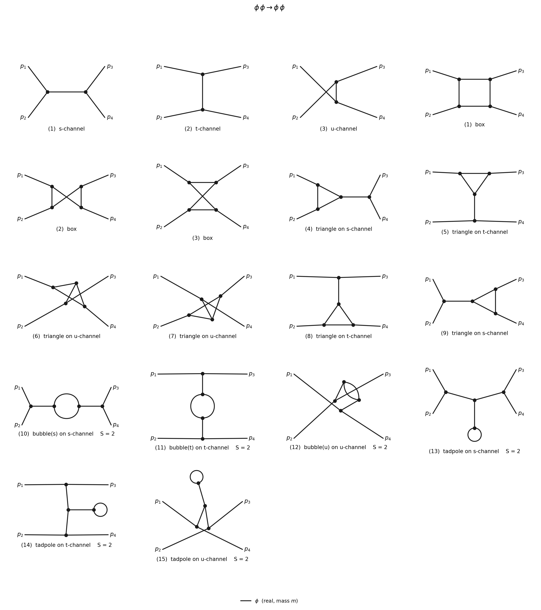

# FeynScalar

Feynman diagrams, symmetry factors and scattering amplitudes for theories of **real and
complex scalar fields** with polynomial interactions.

You give the interaction Lagrangian, the process and the order. FeynScalar then:

1. generates every connected diagram at that order,
2. computes its symmetry factor,
3. routes the momenta,
4. writes the amplitude: tree propagators in Mandelstam variables, one-loop integrals as
   Passarino–Veltman functions `A0, B0, C0, D0`, higher loops as explicit loop integrals,
5. draws the diagrams (Python + matplotlib).



| File | What it is |
|---|---|
| `FeynScalar.wl` | Mathematica package: diagrams, symmetry factors, amplitudes, loop functions |
| `draw_feynman.py` | Python renderer; Mathematica's `DrawDiagrams` calls it automatically |
| `FeynScalar_Examples.nb` | Worked examples (φ⁴, φ³, complex \|χ\|⁴, scalar Yukawa, several couplings) |
| `examples.wls` | The same examples as a script, with 18 checks against textbook results |
| `examples/` | Pictures made by `examples.wls` |

Requirements: Mathematica 13 or later (tested on 14.0) and Python 3 with numpy and matplotlib
(scipy is optional; it gives faster layouts). `DrawDiagrams` finds Python by itself; if it
can't, set `$FeynScalarPython = "/path/to/python3"`.

## Quick start

```mathematica
Get["/path/to/FeynScalar/FeynScalar.wl"]

phi4  = ScalarTheory[{RealScalar[ϕ, m]}, -λ/4! ϕ^4];
FeynmanRules[phi4]                                         (* propagator, vertex -iλ *)

diags = FeynmanDiagrams[phi4, {ϕ, ϕ} -> {ϕ, ϕ}, "Loops" -> {0, 1}];
DiagramTable[diags]                                        (* diagram, S, iM *)
Amplitude[diags]
(*  -λ + λ²/(32π²) (B0[s,m²,m²] + B0[t,m²,m²] + B0[u,m²,m²])  *)

DrawDiagrams[diags, "File" -> "phi4.pdf", "ShowAmplitude" -> True]
```

Load the package in a fresh kernel **before** typing any of its symbols. It defines `p`, `l`,
`s`, `t`, `u`, `A0`, `B0`, `C0`, `D0`, `SP`, `Den`, `DeltaUV`, `MuR`, so don't use these as
your own variable names.

## Input

**Fields**

```mathematica
RealScalar[ϕ, m]          (* real scalar of mass m; RealScalar[ϕ] is massless *)
ComplexScalar[χ, M]       (* complex scalar; conjugate written Conjugate[χ] or via Abs[χ] *)
ComplexScalar[χ, M, χb]   (* also lets you write χb for the conjugate field *)
```

**Interaction Lagrangian**: any polynomial in the fields, for example

```mathematica
-λ/4! ϕ^4 - g/3! ϕ^3
-λ Abs[χ]^4                          (* = -λ (χ* χ)^2 *)
-g ϕ χb χ                            (* scalar Yukawa *)
-κ (χ^3 + Conjugate[χ]^3)            (* charge-violating terms work too *)
-g/2 ϕ1 ϕ2^2 - λ/4 ϕ1^2 ϕ2^2         (* several species *)
```

Each monomial becomes a vertex with factor `i × coefficient × ∏ nᵢ!`. Two-point terms
(mass insertions, mixing) are allowed, but then you must give `"Order"`.

**Process**: `{in…} -> {out…}`, for example `{ϕ, ϕ} -> {ϕ, ϕ}`, `{χ, Anti[χ]} -> {ϕ, ϕ}`,
`{ϕ} -> {χ, χb}` (decay), `{ϕ} -> {ϕ}` (self-energy). `Anti[χ]`, `Conjugate[χ]` and the alias
`χb` all mean the antiparticle.

**Order** (options of `FeynmanDiagrams`)

| Option | Meaning |
|---|---|
| `"Loops" -> L` or `{L1, L2, …}` | loop order (default: tree level) |
| `"Order" -> n` or `{n1, …}` | number of vertices, i.e. power of the coupling |
| `"Order" -> {g -> 2, λ -> 1}` | exact power of each coupling; couplings not listed get power 0 |
| `"Diagrams" -> "Amputated"` | default: connected, no self-energies on external legs (what LSZ needs) |
| `"Diagrams" -> "1PI"` | one-particle-irreducible only |
| `"Diagrams" -> "Connected"` | all connected diagrams (external legs then off shell) |
| `"Tadpoles" -> False` | drop diagrams with tadpoles |
| `"OnShell" -> True/False` | default: on shell, except 2-point functions and `"Connected"` |

## Output

`FeynmanDiagrams` returns a list of `FeynmanDiagram` objects. For a diagram `d`:

| `d["…"]` | |
|---|---|
| `"iM"`, `"M"` | its contribution to i𝓜 and to 𝓜 |
| `"SymmetryFactor"` | S (the amplitude already includes 1/S) |
| `"Integrand"` | the loop integrand with routed momenta; `Den[q, m]` = q² − m² |
| `"Momenta"`, `"Edges"` | momentum of each internal line; lines as `{tail, head, field}` |
| `"Label"` | e.g. `s-channel`, `box`, `bubble(s) on s-channel`, `2-loop` |
| `"Properties"` | all keys |

- `Amplitude[diags]` gives the total 𝓜; `Amplitude[diags, "iM"]` gives i𝓜.
- `DiagramTable[diags]` gives a table; `DiagramTable[diags, "Integrand"]` shows the integrands.
- `DrawDiagrams[diags, opts]` returns an image. Options:
  - `"File" -> "x.pdf"` (also `.png` and `.svg`)
  - `"Columns" -> n`
  - `"ShowMomenta" -> True`
  - `"ShowAmplitude" -> True`
  - `"Separate" -> "figs/d_{id}.pdf"` (one file per diagram)
  - `"LineStyle" -> "Solid" | "Dashed"`
- `ExportDiagrams["d.json", diags]` writes the diagrams as JSON for the Python script.
- `PVExplicit[expr]` writes `A0` in closed form and `B0`, `C0`, `D0` as Feynman-parameter
  integrals.
- `EvaluateLoops[expr, {λ -> 1, m -> 1, s -> 5, t -> -1, u -> 0}, "DeltaUV" -> 0, "Mu" -> 1]`
  returns numbers. `B0` is exact. Above threshold, `C0` and `D0` are integrated along a
  deformed contour; each `D0` takes about 10 s. `DeltaUV` and `MuR` stay symbolic unless
  you give them values.

Drawing from the command line:

```bash
python3 draw_feynman.py diagrams.json -o diagrams.pdf --cols 3 --momenta --amplitude
```

Line styles: real scalars are solid in a theory with only real fields and dashed otherwise.
Complex scalars are solid with an arrow showing particle flow. When a theory has several
interaction terms, vertex dots are coloured by term.

## Conventions

- Metric (+,−,−,−). Propagator i/(p² − m² + iε). L = L_free + L_int.
- Vertex factor = i × (coefficient in L_int) × ∏ nᵢ!. So −λ/4! ϕ⁴ → −iλ, −g/3! ϕ³ → −ig,
  −λ|χ|⁴ → −4iλ, −g ϕχ*χ → −ig.
- ⟨f|S − 1|i⟩ = (2π)⁴ δ⁴(P_f − P_i) i𝓜, and i𝓜 is the sum of the diagrams.
- For a 2-point function, i𝓜 is the sum of 1PI diagrams, i.e. −iΣ(p²) with full propagator
  i/(p² − m² − Σ).
- Momenta: `p[1] … p[n_in]` are incoming and the rest outgoing. Physical momenta satisfy
  Σ p_in = Σ p_out. For 2 → 2: s = (p1+p2)², t = (p1−p3)², u = (p1−p4)², and
  s + t + u = Σ m² is used to simplify.
- One-loop integrals follow LoopTools:
  ∫ d⁴l/(2π)⁴ ∏ᵢ 1/((l+rᵢ)² − mᵢ²) = i/(16π²) × {A0, B0, C0, D0}.
  Argument order is that of LoopTools, e.g. `C0[p1², p2², (p1+p2)², m1², m2², m3²]`.
- Dimensional regularisation with D = 4 − 2ε: `DeltaUV` = 1/ε − γ_E + ln 4π and `MuR` = μ.
  Setting `DeltaUV -> 0` gives MS-bar.
- External particles are bosons, so diagrams are added with no relative signs.

## Checks (`wolframscript -file examples.wls`)

- φ⁴, 2→2: 𝓜 = −λ + λ²/(32π²)[B0(s)+B0(t)+B0(u)] (Peskin & Schroeder 10.20).
- φ⁴ self-energy symmetry factors: 2 (tadpole), 4 (double scoop), 6 (sunset).
- φ⁴, 2→2 at two loops: 12 diagrams with S = 2 (×9) and 4 (×3).
- φ³, 2→2 at one loop: 3 boxes, 6 triangles, 3 bubbles and 3 tadpoles (12 without
  tadpoles, 3 of them 1PI).
- |χ|⁴: χχ→χχ has S = 2 only for the s-channel bubble; χχ̄→χχ̄ has it in the u-channel
  (crossing).
- Scalar Yukawa: χχ̄→χχ̄, χχ→χχ, χχ̄→ϕϕ, ϕ→χχ̄ and the charged-loop self-energy (S = 1).

## How it works

- **Diagrams.** Vertex multisets allowed by the order and by charge/parity counting are
  listed. For each one, multigraphs are built by pairing free legs; identical untouched
  vertices are tried only once.
- **Duplicates.** Graphs are reduced to a canonical form (colour refinement plus
  permutations inside colour classes), and repeats are removed.
- **Symmetry factor.** S is the size of the automorphism group with external legs held
  fixed: vertex automorphisms × m! for each set of m parallel lines × 2 for each real
  self-loop. This equals the Wick-contraction count.
- **Filters.** Amputation, 1PI and the tadpole filters are decided from the bridges of
  each graph.
- **Momenta.** A spanning tree is built; each chord carries a loop momentum, and tree lines
  follow from momentum conservation.
- **Loop integrals.** Loops that share no propagators are factorised (so a chain of two
  bubbles gives B0²). Each one-loop factor is mapped to a scalar n-point function by
  walking around the loop.

## Limitations

- Scalars only, with non-derivative polynomial couplings. There are no counterterms, wave
  function factors (√Z) or renormalisation conditions; add those by hand.
- Integrals with two or more loops that don't factorise are returned unevaluated as
  `LoopIntegral[...]`.
- Numerical `D0` above threshold is good to about 4–5 digits. For precision work, pass
  the `B0`/`C0`/`D0` arguments to LoopTools or Package-X; the argument order is the same.
- Diagram generation is fast up to about 6 vertices (φ³, 2→2 at two loops: 153 diagrams in
  about 1 s). Drawing takes about 0.5 s per diagram.
